# SpendWise IQ

**Know where your money goes, without the work of tracking it.**

[](https://github.com/Bornmajor/smart_expense_tracker/actions/workflows/ci.yml)


SpendWise IQ is a smart, AI-assisted expense tracker that works offline and keeps your data private. On-device text recognition and a plain-language parser make adding an expense almost effortless (scan a receipt, type one line, or paste an M-Pesa message), then smart rules do the thinking for you: it shows how this month compares with last, warns about duplicate charges and price changes, and tells you what is safe to spend today. Everything stays on your phone. There is no account, no cloud and no ads.

It is also a portfolio project: a complete, tested app built the way a production app would be, with a clean architecture, an 80% test-coverage gate and a release pipeline. See [Under the hood](#under-the-hood).

<!-- Screen recording goes here. -->

## Download

Get the latest APK from the [Releases page](https://github.com/Bornmajor/smart_expense_tracker/releases/latest) and open it on your phone. Your phone may ask you to allow installs from your browser or file manager. Every release lists what changed and has a `.sha256` file to check the download against. Builds from the `uat` branch are listed there as **pre-releases**, for people helping to test.

The APK is signed with a different key than a Google Play copy, so one cannot update the other. Use one source per phone.

The app is built with Flutter, one codebase for several platforms. I test and verify it on an Android device only, so that is the build offered here.

## The problem

Most people want to know where their money goes, and most give up tracking it within weeks. Four things get in the way, and each one shaped the app.

| The real problem | What SpendWise IQ does about it |
|---|---|
| **Entering expenses feels like work**, so the habit fades. Research on abandoned budgeting apps keeps finding this ([sources](docs/personas.md#how-much-to-trust-this)) | Three fast ways in: scan a receipt photo or PDF, type "lunch 350 at Java yesterday", or paste an M-Pesa confirmation. The app fills in the form and you only check it |
| **Receipts pile up** and mobile-money messages are buried in the inbox | Text is read from the receipt on your phone. A pasted M-Pesa message becomes an expense, and the same message is never added twice. The app never reads your SMS |
| **Totals do not tell you anything.** A list of numbers does not say what changed or what to do | Plain-language insights: this month against last month, the biggest change, an amount safe to spend each day, and a nudge when a big category has no budget |
| **Finance apps want an account and your data on their server** | No account, no cloud, no tracking. Works with no internet. Optional app lock, an encrypted backup you control, and one button to delete everything |

Who it is for, and what each kind of user expects, is written up in [docs/personas.md](docs/personas.md).

## What it does

### Effortless capture
- **Scan a receipt with on-device AI.** Take a photo, or choose a photo or PDF from your files. The vendor, date and total are read on the phone and a category is suggested. Nothing is saved until you press Save.
- **Type it in one line.** "Lunch 350 at Java yesterday" fills in the form.
- **Paste an M-Pesa message.** The amount, the name and the transaction code are picked out for you.
- **Repeat it.** Tick "Repeat this expense" and a rent, a subscription or a bill is added automatically when it falls due.
- **Other currencies.** Convert an amount with the latest daily exchange rate.
- **Remembers you.** The category you use for each vendor is suggested next time.

### Smart insights that say something
- **This month against last month**, over the same stretch of days, with the biggest change by category.
- **Safe to spend:** an amount a day for the rest of the month, after what you have spent and the bills still to come.
- **Heads-up cards:** a possible duplicate charge, an unusually large expense, a category above its usual month, a subscription that changed price, and a big category with no budget.
- **Budgets** for each category and overall, drawn on the year chart and on each category card, turning amber near the limit and red once passed.
- **A Home screen** that puts the month, the year and the latest expenses in one glance, in whole shillings.

### Your data stays yours
- **Offline and on-device:** storage, text recognition and every insight run on the phone.
- **App lock** with fingerprint, face or the phone's screen lock, and never a way to lock yourself out.
- **Backup and restore** to a file in your Downloads folder, optionally locked with a password (AES-256).
- **Export** any month as a PDF report or a CSV spreadsheet. **Search and filter** by vendor, category, dates and amount.
- **Delete all my data** puts the app back to a fresh install.

The full list, and what is still to come, is in [docs/features.md](docs/features.md) and the [roadmap](docs/roadmap.md).
## Screenshots

### First run

<table>
  <tr>
    <td align="center"><br><sub>Welcome</sub></td>
    <td align="center">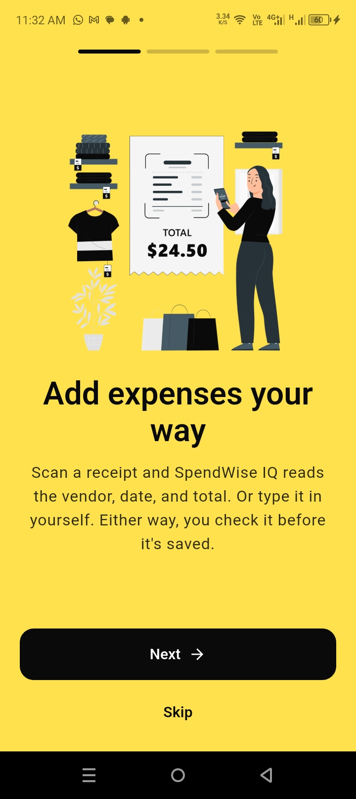<br><sub>Add expenses your way</sub></td>
    <td align="center"><br><sub>See where it goes</sub></td>
    <td align="center">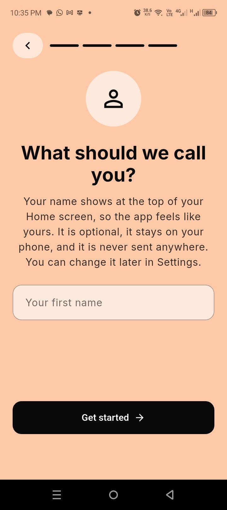<br><sub>An optional name</sub></td>
  </tr>
</table>

### Home and Summary

The month against the budget, a comparison with last month, a year chart with the budget line, and where the money went.

<table>
  <tr>
    <td align="center">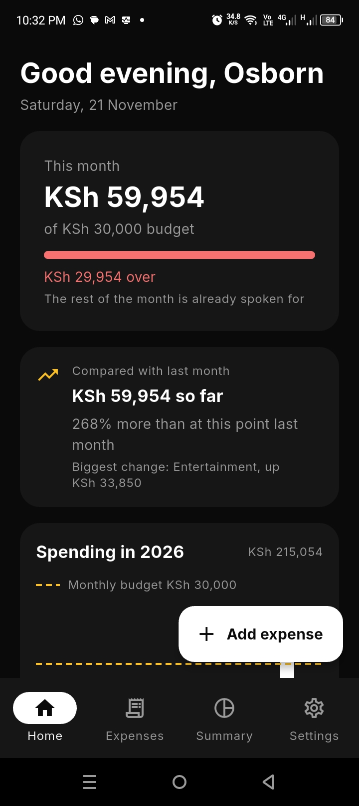<br><sub>Home</sub></td>
    <td align="center">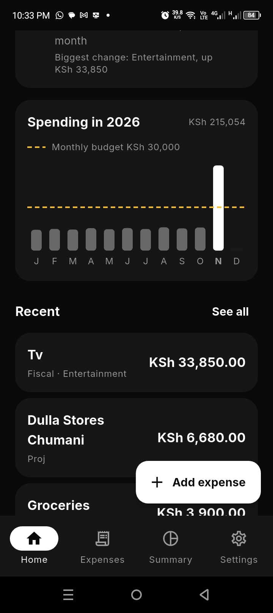<br><sub>The year</sub></td>
    <td align="center">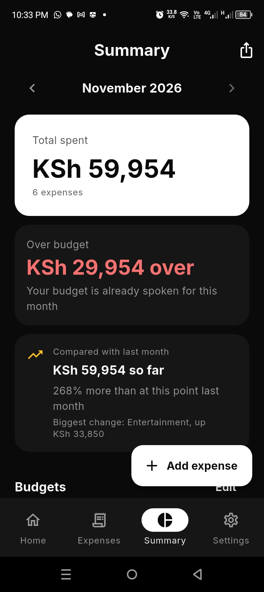<br><sub>Summary</sub></td>
    <td align="center">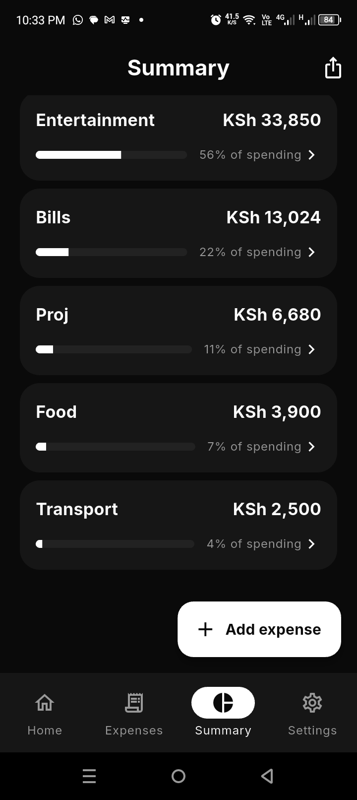<br><sub>By category</sub></td>
  </tr>
</table>

### Adding, finding and keeping your data

<table>
  <tr>
    <td align="center">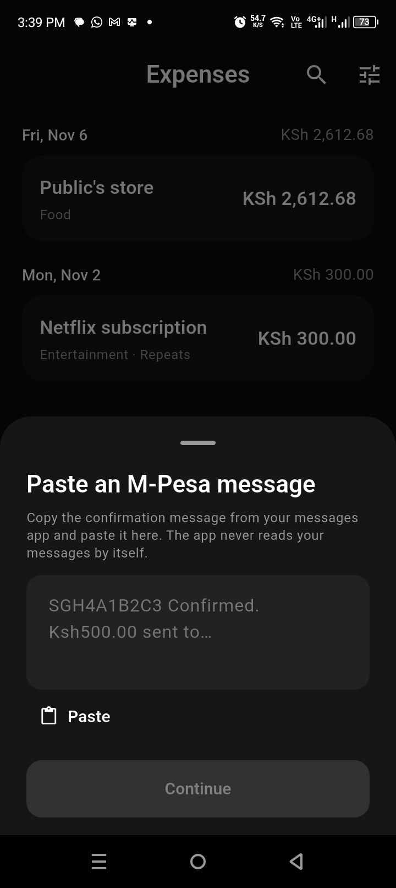<br><sub>Paste an M-Pesa message</sub></td>
    <td align="center">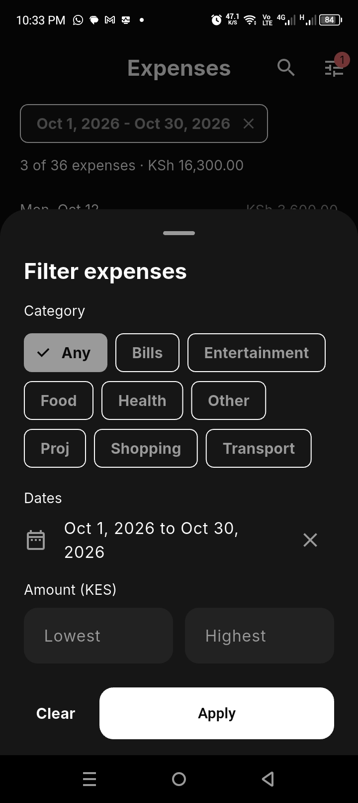<br><sub>Search and filter</sub></td>
    <td align="center">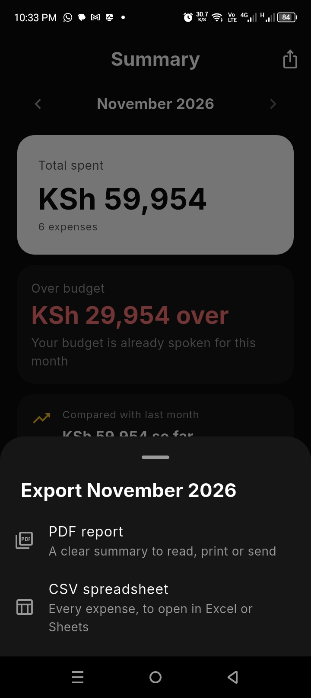<br><sub>Export a month</sub></td>
    <td align="center">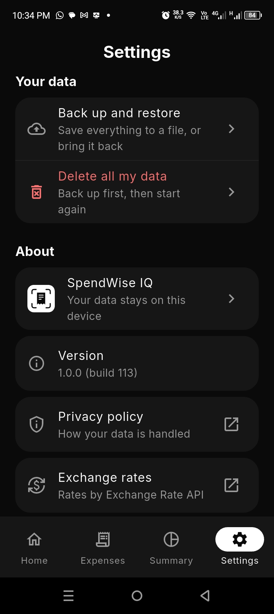<br><sub>Back up and restore</sub></td>
  </tr>
</table>

### Scanning a receipt

Choose a receipt photo or PDF and the vendor, date and total are read on the phone and filled in. A note says what to double-check, and nothing is saved until you press Save.

<table>
  <tr>
    <td align="center">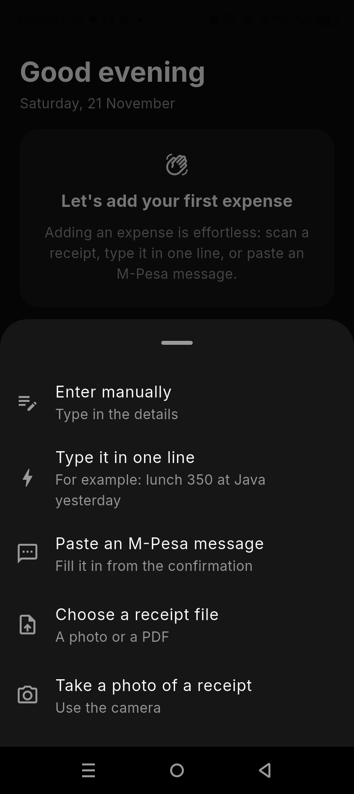<br><sub>1. Choose how to add</sub></td>
    <td align="center">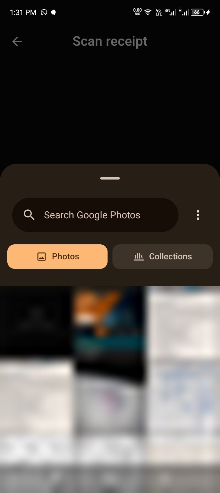<br><sub>2. Pick a receipt photo</sub></td>
    <td align="center">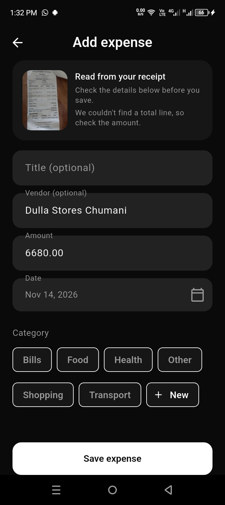<br><sub>3. Check what was read</sub></td>
    <td align="center"><br><sub>4. Saved</sub></td>
  </tr>
</table>

Captured on a real phone with the dark theme.

## Under the hood

- **Feature-first clean architecture.** Each feature has domain, data and presentation layers. Business rules are plain Dart with no Flutter or database imports, so they are fast to test. See [docs/architecture.md](docs/architecture.md).
- **Tested where it matters.** Business logic, repositories, state and reusable widgets have tests, and CI fails below **80% coverage** (88.9% today). Layout tests check that screens fit a narrow phone at large text sizes.
- **Offline-first.** A local SQLite database (drift) with versioned migrations. The only network call is one small exchange-rate request a day, for converting amounts.
- **Built for flaky hardware.** The app recovers a receipt photo, and tells the user what happened, when the phone closes it for memory while the camera or the file picker is open.
- **Release pipeline.** GitHub Actions runs format, analysis and tests on every pull request, builds dev and prod flavors, and publishes signed APKs with checksums. Work flows `dev`, then `uat` (pre-release), then `main`. See [docs/branching.md](docs/branching.md) and [docs/releasing.md](docs/releasing.md).
- **Honest privacy policy.** What the app does with your data is written down in [docs/privacy-policy.md](docs/privacy-policy.md).

### Tech stack

| Area | Technology |
|---|---|
| Framework | Flutter 3.47 (Dart 3.13), Material 3, light and dark themes, Inter font |
| State and navigation | `flutter_bloc` (Cubit), `equatable`, `go_router` |
| Storage | `drift` (SQLite), `shared_preferences` |
| Receipts | `image_picker` (camera), `file_selector` (Files app), `pdfx` (draws a PDF page), `google_mlkit_text_recognition` (on-device OCR) |
| Reports and backup | `pdf`, `share_plus`, `cryptography` (PBKDF2 + AES-256-GCM) |
| Security | `local_auth` (biometrics and screen lock) |
| Exchange rates | `http` (one daily request to ExchangeRate-API) |
| Testing and CI | `flutter_test`, `bloc_test`, GitHub Actions, an 80% coverage gate |

## More documentation

| Doc | What is in it |
|---|---|
| [Features](docs/features.md) | Everything the app does, and what is still to come |
| [Roadmap](docs/roadmap.md) | The build order and why |
| [Personas](docs/personas.md) | Who the app is for, with sources |
| [First-screen research](docs/first-screen-research.md) | Why the Home screen looks the way it does |
| [Architecture](docs/architecture.md) | Folder layout, data flow and conventions |
| [Privacy policy](docs/privacy-policy.md) | What happens to your data |
| [Changelog](CHANGELOG.md) | What changed, release by release |
| [Sample backup](docs/sample-backup-2026.json) | A year of sample spending to restore and see the charts with data |
## Getting started

### Prerequisites

- [Flutter SDK](https://docs.flutter.dev/get-started/install) **3.47.2** (Dart 3.13.2) or newer on the stable channel
- An IDE with the Flutter tools (Android Studio or VS Code) and a device or emulator. The app is only tested on an Android device
- A connected device or emulator. Camera features will need a real device.

Check your setup:

```bash
flutter doctor
```

### Install

```bash
git clone <your-repo-url>
cd smart_expense_tracker
flutter pub get
```

### Run

```bash
flutter run                        # dev flavor: installs as "SpendWise IQ Dev"
flutter run --release              # release build (code shrinking on), still dev
```

Without `--flavor`, builds use the **dev** flavor (`com.bornmajor.spendwiseiq.dev`), so they install next to the Google Play app instead of failing to replace it. Only the release pipeline builds the **prod** flavor. See [releasing](docs/releasing.md#flavors).

Pick a device when prompted, or pass one with `-d <device-id>` (list them with `flutter devices`).

### Test

```bash
flutter test                       # run all tests
dart run tool/coverage.dart        # run tests and enforce 80% coverage
```

We test business logic, utility functions and reusable UI components rather than everything. The coverage script counts every file under `lib/` (not only files a test imports) and skips entry points and generated code.

### Continuous integration

Every pull request into `dev`, `uat` or `main`, and every push to `dev`, runs the workflow in [`.github/workflows/ci.yml`](.github/workflows/ci.yml). A push to `uat` or `main` runs it as the first job of the release workflow:

1. Formatting check (`dart format`)
2. Static analysis (`flutter analyze --fatal-infos`)
3. Tests with a minimum 80% coverage gate

Releases are separate. Work lands in `dev` (no upload), `uat` sends a build to Play internal testing, and `main` sends one to production after you approve it, all through [`release.yml`](.github/workflows/release.yml). See [docs/branching.md](docs/branching.md) for the branch flow, [docs/releasing.md](docs/releasing.md) for the setup, and the [release checklist](docs/release-checklist.md). User-facing changes go in [CHANGELOG.md](CHANGELOG.md).

Run the same checks locally before opening a pull request:

```bash
dart format --output=none --set-exit-if-changed .
flutter analyze --fatal-infos
dart run tool/coverage.dart
```
