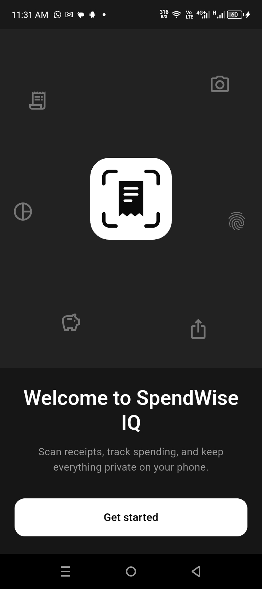
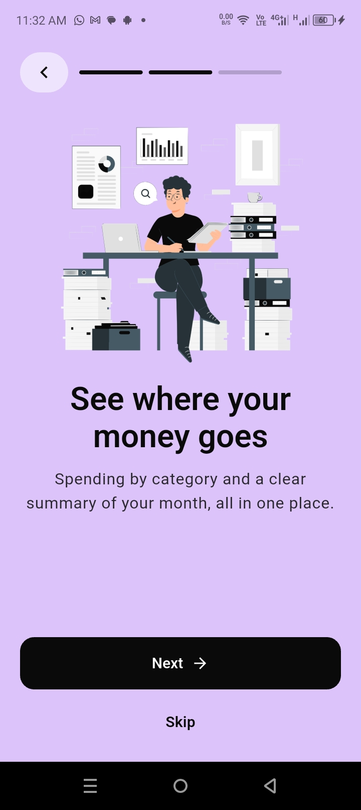
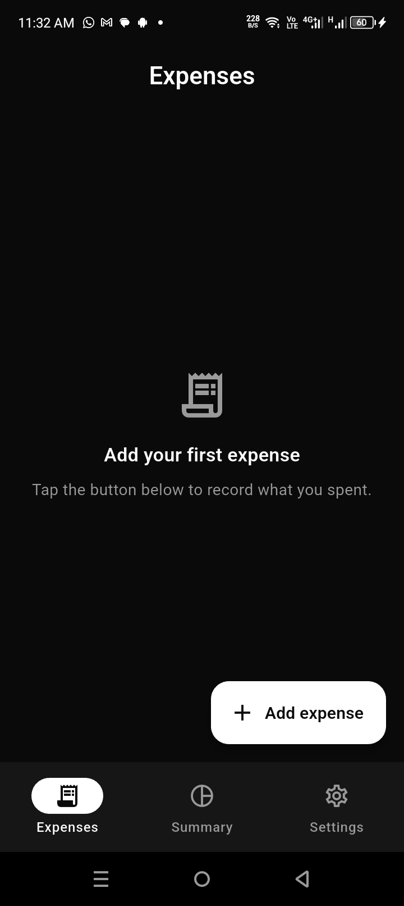
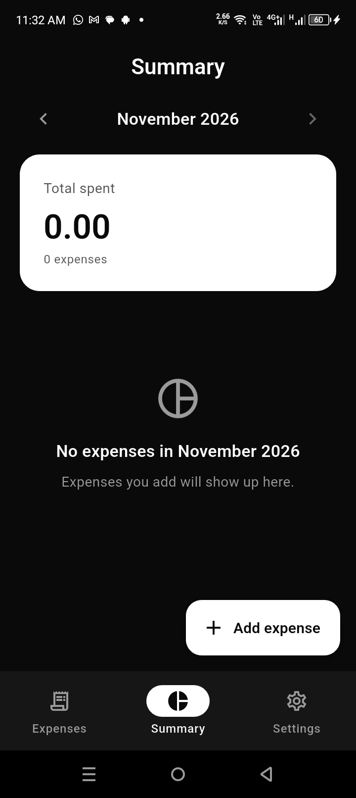
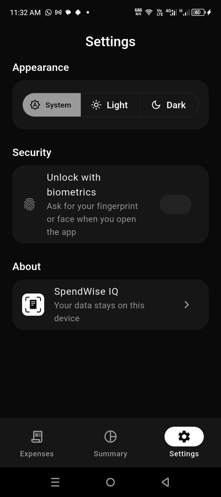
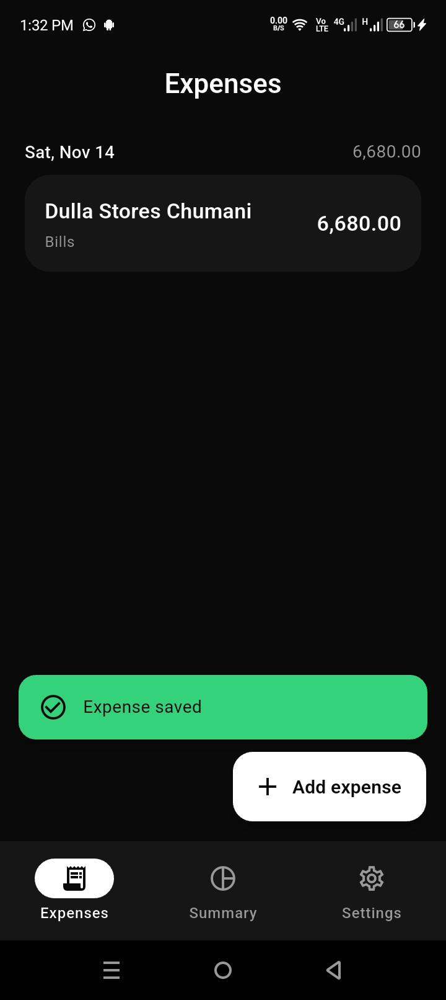

# SpendWise IQ

**Snap a receipt. Know where your money goes.**

SpendWise IQ is a smart, privacy-first expense tracker. Point your camera at a receipt and the app reads the vendor, date and total on your device, suggests a category, and lets you confirm the details before saving. No typing, no account, no cloud.

## Download

Get the latest Android APK from the [Releases page](https://github.com/Bornmajor/smart_expense_tracker/releases/latest), open it on your phone, and allow installs from your browser or file manager if Android asks. Every release lists what changed and has a `.sha256` file to check the download against. The first release appears there once the app goes to production. Test builds from the `uat` branch are listed on the [Releases page](https://github.com/Bornmajor/smart_expense_tracker/releases) as **pre-releases**, for people helping to test.

The APK is signed with a different key than the one Google Play uses, so a copy installed from the APK cannot be updated from Google Play, or the other way round. Use one source per phone.

## Screenshots

<table>
  <tr>
    <td align="center"><br><sub>Welcome</sub></td>
    <td align="center"><br><sub>Onboarding</sub></td>
    <td align="center"><br><sub>Onboarding</sub></td>
  </tr>
  <tr>
    <td align="center"><br><sub>Expenses</sub></td>
    <td align="center"><br><sub>Monthly summary</sub></td>
    <td align="center"><br><sub>Settings</sub></td>
  </tr>
</table>

### Scanning a receipt

Choose a receipt photo or PDF and the vendor, date and total are read on the phone and filled in. A note says what to double-check, and nothing is saved until you press Save.

<table>
  <tr>
    <td align="center"><br><sub>1. Choose how to add</sub></td>
    <td align="center"><br><sub>2. Pick a receipt photo</sub></td>
    <td align="center"><br><sub>3. Check what was read</sub></td>
    <td align="center"><br><sub>4. Saved</sub></td>
  </tr>
</table>

Captured on an Android phone with the dark theme. Scanning a receipt photo or PDF chosen from the Files app works; taking the photo with the camera is still planned (see [Features](#features)).

## The problem it solves

Most people want to know where their money goes, but tracking it is tedious. Receipts pile up, typing each purchase takes too long, and the habit fades after a week. The apps that automate it usually ask for an account and upload financial data to a server.

SpendWise IQ removes the effort and keeps the data private:

- **Scan instead of type.** On-device text recognition turns a photo of a receipt into an expense in seconds.
- **Smart, but you stay in control.** The app fills in the form and suggests a category. You verify and correct it before anything is saved, so records stay accurate.
- **Private and offline-first.** Everything is stored on your phone and works without internet.
- **Clear picture of your spending.** Monthly totals, category breakdowns and budgets show what is happening and warn you before you overspend.

## Features

Status: `[x]` implemented, `[ ]` planned. Planned items that are never built will be removed from this list before release.

### Implemented

- [x] Light and dark themes with a shared design system (colors, spacing, typography)
- [x] Welcome screen and three-step onboarding, shown once
- [x] Manual expense entry with validation (optional title and vendor), stored offline on the device
- [x] Expense list grouped by day, with daily totals and category names
- [x] Edit an expense, or delete it by swiping (with Undo) or from the edit screen
- [x] Categories you manage yourself: create, rename and delete (deleting moves the expenses to Other)
- [x] Add a category from the expense form with the New chip, without losing what you typed
- [x] Monthly summary: total and spending by category, with a month switcher
- [x] Settings: theme (system, light, dark) and About
- [x] Optional app lock with fingerprint, face or the phone's screen lock, turned on from Settings. If the phone can no longer check you, the lock screen offers to turn the lock off, so you are never locked out of your own data
- [x] Scan a receipt: choose a photo and the app reads the vendor, date and total on your phone, suggests a category, and fills the expense form for you to check before saving. The photo is temporary and is deleted afterwards
- [x] Export a month as a PDF report or a CSV spreadsheet from the Summary screen, shared or saved from the system share sheet. Nothing is uploaded by the app; the file goes only where you send it
- [x] Choose the currency amounts are shown in (it starts with the currency of the phone's country). Saved amounts are relabelled, not converted
- [x] Remember the category you use for each vendor, so the next expense or scan starts with it
- [x] Monthly budgets for each category and overall, with progress bars on the Summary that turn amber near the limit and red when passed
- [x] Recurring expenses and subscriptions, added automatically when they come due (weekly, monthly or yearly), with what they add up to each month. A "Repeat this expense" box on the add form turns a scanned or typed bill into one
- [x] Convert an amount in another currency with the latest daily rate (downloaded once a day, saved on the phone, rate and date shown)
- [x] "Safe to spend" on the Summary: an amount a day for the rest of the month, after spending so far and upcoming recurring bills (needs an overall budget)
- [x] Heads-up cards on the Summary: possible duplicate charge, unusually large expense, a category above a usual month (rules on the phone, nothing sent anywhere)
- [x] Back up everything to a file (optionally password-protected with AES-256) and restore it, with a confirmation that shows what is in the backup
- [x] Tap a Summary category or budget to open the expenses behind it for that month
- [x] Search expenses by vendor or title and filter them by category, dates and amount

### Planned

**MVP: scan, track, export**
- [ ] Scan a receipt with the camera (choosing a photo or PDF from the Files app works today; see the [roadmap](docs/roadmap.md))

**After the MVP** (see the [roadmap](docs/roadmap.md) for the build order)
- [ ] Prompt sheet that introduces features and pending tasks, with "Remind me later" and "Not interested"
- [ ] Search and filters (date, category, amount, vendor)
- [ ] More charts and insights
- [ ] Multi-currency
- [ ] Optional receipt attachment

## Tech stack

| Area | Technology | Status |
|---|---|---|
| Framework | Flutter 3.47 (Dart 3.13), Material 3 | In use |
| Theming | `ThemeData` + `ThemeExtension`, light and dark | In use |
| CI | GitHub Actions (format, analyze, test, coverage) | In use |
| Local database | `drift` (SQLite) | In use |
| State management | `flutter_bloc` (Cubit), `equatable`, `bloc_test` for tests | In use |
| Navigation | `go_router` | In use |
| Settings storage | `shared_preferences` | In use |
| Biometrics | `local_auth` | In use |
| Camera | `camera` / `image_picker` | Planned |
| On-device OCR | `google_mlkit_text_recognition` (ML Kit) | Planned |
| Charts | `fl_chart` (if a chart is added) | Planned |
| Export | `pdf`, `share_plus` (CSV is written by hand) | In use |
| Receipt files | `file_selector` (Files app), `pdfx` (draws a PDF page) | In use |
| Exchange rates | `http` (one daily request to ExchangeRate-API) | In use |
| App version | `package_info_plus` | In use |
| Backup encryption | `cryptography` (PBKDF2 + AES-256-GCM) | In use |

## Architecture

The app uses a feature-first structure with domain, data and presentation layers in each feature. See [docs/architecture.md](docs/architecture.md) for the folder layout, data flow and conventions.

## Getting started

### Prerequisites

- [Flutter SDK](https://docs.flutter.dev/get-started/install) **3.47.2** (Dart 3.13.2) or newer on the stable channel
- Android Studio (Android SDK and emulator) and/or Xcode (macOS, for iOS)
- A connected device or emulator. Camera features will need a real device.

Check your setup:

```bash
flutter doctor
```

### Install

```bash
git clone <your-repo-url>
cd smart_expense_tracker
flutter pub get
```

### Run

```bash
flutter run                        # dev flavor: installs as "SpendWise IQ Dev"
flutter run --release              # release build (code shrinking on), still dev
```

Without `--flavor`, builds use the **dev** flavor (`com.bornmajor.spendwiseiq.dev`), so they install next to the Google Play app instead of failing to replace it. Only the release pipeline builds the **prod** flavor. See [releasing](docs/releasing.md#flavors).

Pick a device when prompted, or pass one with `-d <device-id>` (list them with `flutter devices`).

### Test

```bash
flutter test                       # run all tests
dart run tool/coverage.dart        # run tests and enforce 80% coverage
```

We test business logic, utility functions and reusable UI components rather than everything. The coverage script counts every file under `lib/` (not only files a test imports) and skips entry points and generated code.

### Continuous integration

Every pull request into `dev`, `uat` or `main`, and every push to `dev`, runs the workflow in [`.github/workflows/ci.yml`](.github/workflows/ci.yml). A push to `uat` or `main` runs it as the first job of the release workflow:

1. Formatting check (`dart format`)
2. Static analysis (`flutter analyze --fatal-infos`)
3. Tests with a minimum 80% coverage gate

Releases are separate. Work lands in `dev` (no upload), `uat` sends a build to Play internal testing, and `main` sends one to production after you approve it, all through [`release.yml`](.github/workflows/release.yml). See [docs/branching.md](docs/branching.md) for the branch flow, [docs/releasing.md](docs/releasing.md) for the setup, and the [release checklist](docs/release-checklist.md). User-facing changes go in [CHANGELOG.md](CHANGELOG.md).

Run the same checks locally before opening a pull request:

```bash
dart format --output=none --set-exit-if-changed .
flutter analyze --fatal-infos
dart run tool/coverage.dart
```
